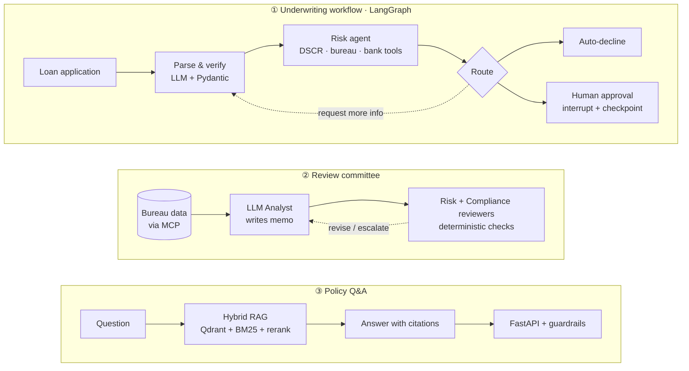

<h1 align="center">Hi, I'm Abhiram Aedunoothala 👋</h1>

  

  
  

---

### 🧭 About me

- 🤖 I build **agentic AI systems**: LangGraph workflows, hybrid RAG, multi-agent review, and the evaluation and guardrails that make them trustworthy
- 🎓 **Computer Science at the University of Michigan** (2026–2029), transferred from Penn State (GPA 3.7, Dean's List, President Walker Award)
- 📜 Applied AI Professional Certification, **IIT Hyderabad** (2026)
- 🧑‍🏫 Learning Assistant for MATH 110 at Penn State
- 🏸 Competitive badminton player, state and national level in India

---

### 🌟 Spotlight: [WealthPilot](https://github.com/abhi-1006/wealthpilot)

**An AI copilot for SME loan underwriting** · IIT Hyderabad Applied AI capstone · Jun–Aug 2026

WealthPilot parses raw small-business loan applications, scores risk with a tool-calling agent, answers credit-policy questions with cited sources, pauses risky decisions for a human, and has every memo checked by a review committee. In regulated lending, two failures matter most: **using a protected attribute** and **fabricating a policy citation**. The system is built and evaluated around preventing both.

| What I built | Why it matters |
|---|---|
| **Hybrid RAG**: Gemini embeddings in Qdrant + BM25, RRF fusion, cross-encoder reranking, prompted to cite sources | Answers point to the actual policy clause instead of inventing one |
| **LangGraph workflow** with a real `interrupt()` human gate and a durable SQLite checkpointer | A paused approval survives a restart. Verified by resuming from disk with a fresh connection and graph |
| **Multi-agent committee**: LLM analyst + deterministic risk and compliance critics with enforced per-agent write scopes | Critics can't edit the memo they're checking, so the checks stay independent |
| **MCP server** for credit-bureau data | Tools are exposed through a standard protocol instead of hard-wired calls |
| **Reliability**: retries with backoff, a fallback path, and a circuit breaker, under seeded fault injection; Langfuse tracing | A flaky dependency degrades gracefully, and every decision can be traced |
| **Evaluation & guardrails**: a 20-item golden set, three independent LLM-judge frameworks, and schema, prompt-injection and protected-attribute checks behind FastAPI | Quality is measured, not assumed |

**Results**

| Metric | Result |
|---|---|
| Retrieval MRR (dense → hybrid → hybrid + rerank) | **0.74 → 0.82 → 1.00** |
| Policy golden set | **19/20** (started at 6/20; two real bugs found and fixed) |
| Faithfulness / groundedness (Ragas, TruLens) | **1.0 / 1.0** |
| Valid credit-bureau lookups under fault injection | **45% → 85%** with retries; the rest fall back to a flagged record instead of crashing |

`Python` `LangGraph` `LiteLLM` `Qdrant` `Gemini embeddings` `MCP` `FastAPI` `Langfuse` `Ragas` `DeepEval` `TruLens`

---

### 🗂️ Other projects

| Project | What it is | Stack |
|---|---|---|
| 🏔️ [**FoczTrek**](https://github.com/abhi-1006/FoczTrek) · [demo](https://focztrek.vercel.app) | Student productivity app (Eisenhower Matrix planning + Pomodoro focus timers), built during a research internship with **Duke University** (Dr. Eric Fouh), 2024–25 | React Native, Expo, TypeScript |
| 💡 [**Distraction-Free Study Lamp**](https://github.com/abhi-1006/Distraction-Free-Study-Lamp) | Two Micro:bits over radio: a Pomodoro timer that pauses when a light sensor detects you picked up your phone | MicroPython, Micro:bit |

---

### 🛠️ Tech stack

**AI & LLM engineering**

  
  
  
  
  
  
  
  

**Languages**

  

**Frameworks & tools**

  

---

  <i>Open to AI engineering and software engineering internships. Let's talk!</i>  
  <a href="https://www.linkedin.com/in/abhiram-aedunoothala">LinkedIn</a> ·
  <a href="mailto:avsabhiram1006@gmail.com">Email</a>

